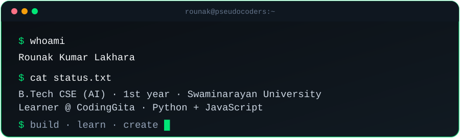
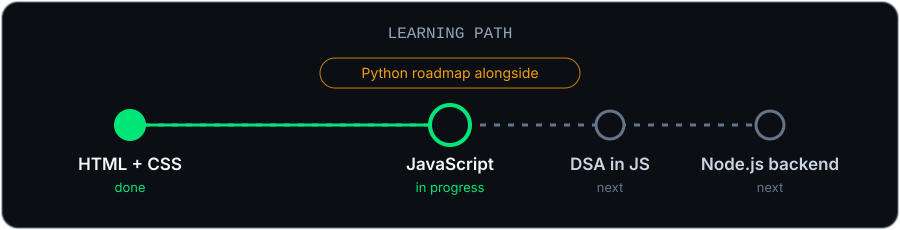

  

<h3 align="center">
  <samp>&gt; Hey there! I am <b><a target="_blank" href="https://www.linkedin.com/in/rounak-kumar-lakhara-52825b427/">Rounak Kumar Lakhara</a></b></samp>
</h3>

  <samp>「 First-year B.Tech CSE (AI) student building web projects and learning to think like a programmer 」</samp>

  

## 👋 About Me

- 🎓 First-year **B.Tech Computer Science (AI)** at **Swaminarayan University**
- 💻 Learner at **CodingGita**
- 🧠 Goal: not just learn syntax, but **think like a programmer**, solve unfamiliar problems and build real projects
- 🌱 Currently following a **30-day JavaScript roadmap** (variables → loops → arrays → functions → DOM → async → final project)
- 🚀 Brand I'm building: **PseudoCoders Tech** — *Build · Learn · Create*
- 🗣️ I talk in **Hinglish + English**

## 🛠 Tech & Tools

  &nbsp;
  &nbsp;
  &nbsp;
  &nbsp;
  &nbsp;
  &nbsp;
  &nbsp;
  &nbsp;
  

HTML · CSS · JavaScript · Python · Java · Node.js (learning) · Figma · Git/GitHub

## 🧪 Projects

| Project | What it is | Stack |
| --- | --- | --- |
| **EventHub** | Built with Team **RenderX** for the CodingGita PixelRush 2026 UI/UX + Frontend Hackathon | HTML · CSS · JS · Figma |
| **PseudoIQ** | MCQ practice web app; evolving into a "upload any PDF → get MCQs by subject" platform | In progress |
| **Minecraft-style Portfolio** | Interactive portfolio with a Minecraft hotbar UI, 3D backgrounds and my own skin | In progress |
| **"The Series" Portfolio** | Netflix-style portfolio, adapted from an open-source React template | React · TypeScript · Vite |

<!-- TODO: add repo / live links for each project once they are public -->

More details: [docs/PROJECTS.md](./docs/PROJECTS.md) · Learning log: [docs/LEARNING.md](./docs/LEARNING.md)

## 🏆 Certificates & Achievements

- 🎖️ **CodingGita PixelRush 2026** — UI/UX + Frontend Hackathon participation (5–6 Oct 2026)
- 🎖️ **CampusCrew** — 100K Milestone Honor (26 June 2026)
- 📜 **Unstop** — HTML with AI · CSS with AI · JavaScript ES6 with AI
- 📜 **Node JS** — Certificate of Completion

## 📊 GitHub Stats

  

  

## 🤝 Let's Connect

  
  &nbsp;
  

<!-- TODO: add an email badge when you decide which email to show:
 -->

I'm open to hackathons, team projects and web-dev collaborations. 🚀

  ⚡ Build the ideas that matter. · Star ⭐ the repos if they helped you!

  

